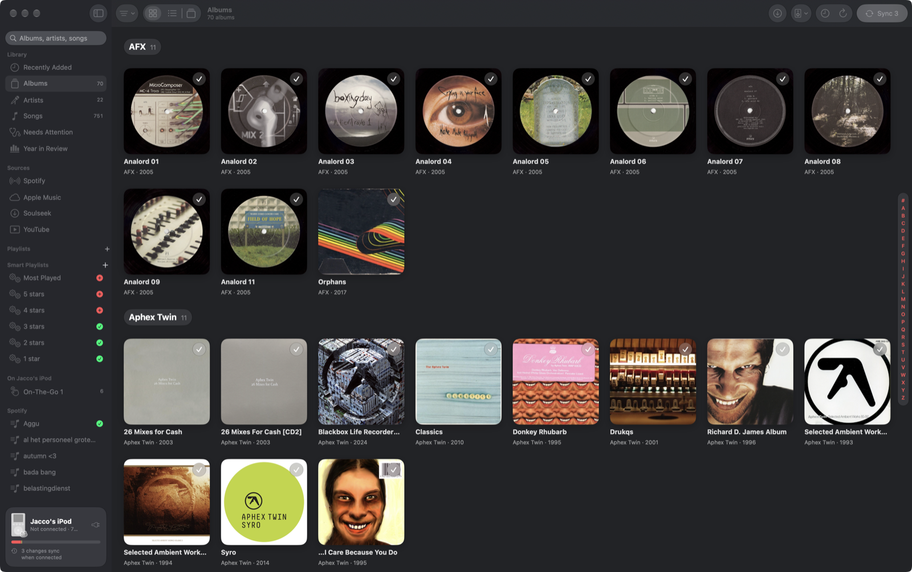

# Crate

A Mac app for the classic iPod (built for the 3rd generation): your music folders on one side, the iPod on the other, and a sync that keeps them together. It replaces iTunes/Finder syncing for iPods that macOS no longer manages well.



## What it does

- **Library**: reads your music folders (local or on network shares) by tags; albums, artists, songs, Cover Flow, Recently Added, Year in Review.
- **iPod sync**: queue albums, songs and playlists, review the changes, sync. Converts FLAC/ALAC to AAC, writes the iTunesDB directly, keeps play counts, ratings and On-The-Go playlists, and merges plays made on the iPod back in.
- **Smart playlists**, Sound Check, an organiser, a tag editor, cover tools and a library health check (missing covers, duplicates, low bit rates).
- **Playback** on this Mac, with the iPod drawn in the sidebar as the remote (wheel for volume), or on Music Assistant speakers.
- **Frogger**: optional patched-firmware support for the 3rd gen iPod (hidden playlists, skips).

## Plugins

Everything that talks to another service is a plugin you can switch off (Settings › Plugins). With all of them off, Crate is a plain folders → iPod manager that keeps its music in `~/Music/Crate`.

| Plugin | What it adds |
|---|---|
| Subsonic | A Navidrome/Subsonic server's library and playlists; rescans after imports; scrobbles the iPod's plays |
| Music Assistant | Its speakers and groups in the toolbar; Play and the controls drive its queue |
| Spotify | Your saved albums and playlists (Web API, your own Client ID): what you have files for, copy playlists to the iPod |
| Soulseek | Search and download through your slskd server, imported into the library |
| Apple Music | Import iTunes Match albums from the Music app |
| YouTube | Download songs, playlists or a playlist's missing songs with yt-dlp, tagged with covers |

## Building

Needs macOS 26 and the Xcode Command Line Tools (no Xcode project):

```sh
./build.sh        # optimised build into build/Crate.app
./build.sh dev    # faster to compile, slower to run
open build/Crate.app
```

With a code-signing identity named "Crate Local Signing" in your keychain, builds keep their macOS permissions between rebuilds; otherwise they're signed ad hoc.

## Layout

```
Sources/App       app entry, main window, settings, player, menu bar
Sources/Library   library loading, albums/artists/songs, tags, metadata, organiser, health
Sources/iPod      iTunesDB, iPod sync, artwork, Frogger, disk repair
Sources/Plugins   Subsonic, Music Assistant, Spotify, Soulseek, Apple Music, YouTube
Resources         Info.plist, icon, the iPod LCD font
docs/NOTES.md     detailed notes, file formats and command-line test flags
```

## License

MIT, see [LICENSE](LICENSE). The ChicagoFLF font is in the public domain.
